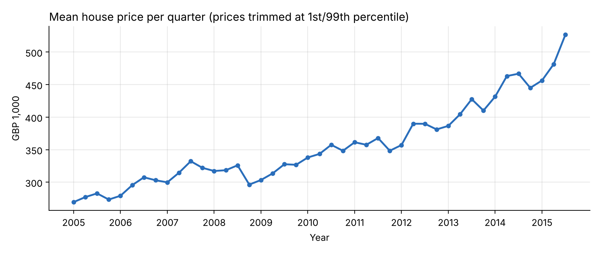
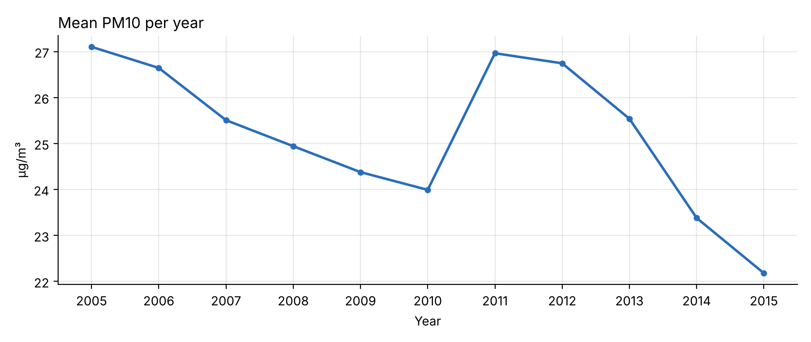

# Overview: House Prices and Air Pollution in London

Generated by `data_exploration.py` from `data/land_registry_pollution.dta`.

## Data

- Land Registry house sales in London, 2005-01-01 to 2015-07-30.
- **Prices are trimmed:** the bottom and top 1% of sale prices are dropped,
  i.e. sales below GBP 104,000 and above GBP 1,850,000.
  This removes 8,843 of 450,885 sales and leaves **442,042 sales**.
- Air pollution is measured as PM10 (particulate matter, µg/m³) at the monitoring site nearest to each home, averaged over the year.
- 2015 only covers sales up to July.

## House prices over time

The mean price rose from GBP 269,504 in 2005Q1 to GBP 526,780 in 2015Q3.

## Air pollution over time

PM10 is recorded as a yearly average, so it is shown per year (mean over all sales in that year).
Mean PM10 went from 27.1 µg/m³ in 2005 to 22.2 µg/m³ in 2015.
The decline is not steady: after 2005, the highest value is in 2011 (27.0 µg/m³).

## Simple regression

ln(price) = a + b · PM10 + e, estimated by OLS on the trimmed sample, robust standard errors.

| | Coefficient | Std. error | t-stat |
|---|---|---|---|
| Constant | 12.5542 | 0.0036 | 3449.8 |
| PM10 | 0.00141 | 0.00014 | 10.1 |

Observations: 442,042. R²: 0.0002.

**Interpretation:** one extra µg/m³ of PM10 goes together with a 0.14% higher price.
This regression has no controls, so it is only a correlation: PM10 is higher near the centre,
where homes are more expensive for other reasons. It is not an estimate of the willingness to pay for clean air.
